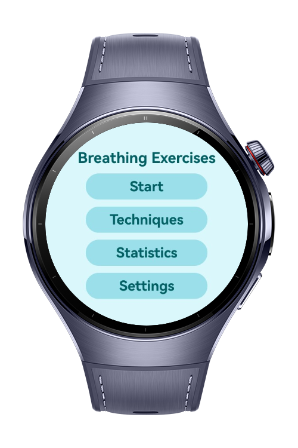
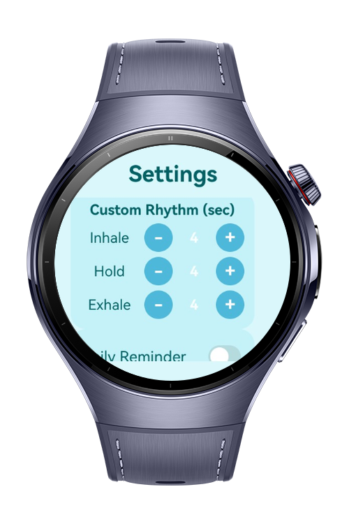
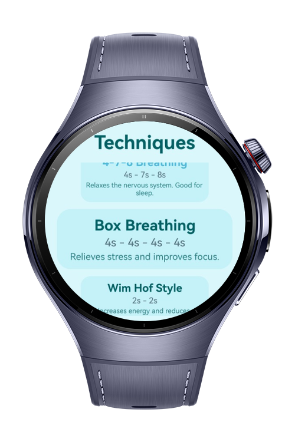

# Breathing Exercises

This app guides you through quick and powerful breathing exercises that eliminate stress & anxiety, increase energy, improve endurance, and help you fall asleep.

# Preview

<div>
  
  
  
  
</div>

# Use Cases

- Changeable Inhale/Hold/Exhale timer and speed from the settings for your custom exercise
- Ability to pick predetermined techniques form the Techniques Page and ability to pick your custom exercise
- Statistics Page to show how many consecutive days breathing exercises are done and to see total time
- Daily reminder in the Settings Page 

# Tech Stack

- **Languages**: ArkTS, ArkUI
- **Frameworks**: HarmonyOS SDK 5.1.0(18)
- **Tools**: DevEco Studio Version 5.1.1.823
- **Libraries**:
    - `@kit.ArkUI`
    - `@kit.ArkTS`
    - `lottie`

# Directory Structure

```
entry/src/main/ets/
├───animation
│       Breath.json
├───entryability
│       EntryAbility.ets
├───entrybackupability
│       EntryBackupAbility.ets
├───modifier
│       TextModifier.ets
├───pages
│       Index.ets
│       Main.ets
│       Settings.ets
│       StatsPage.ets
│       SummaryPage.ets
│       TechniquesPage.ets

```

# Constraints and Restrictions

## Supported Device

* Huawei Watch 5

# License

**Breathing Exercises** is distributed under the terms of the MIT License
See the [LICENSE](./LICENSE) for more information.